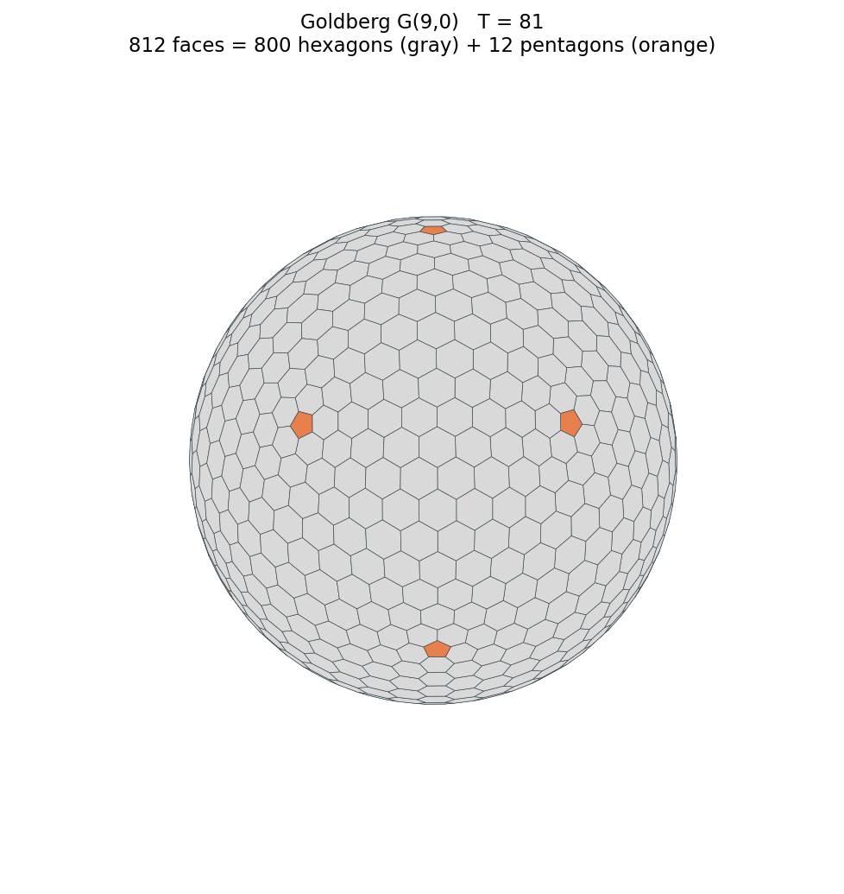
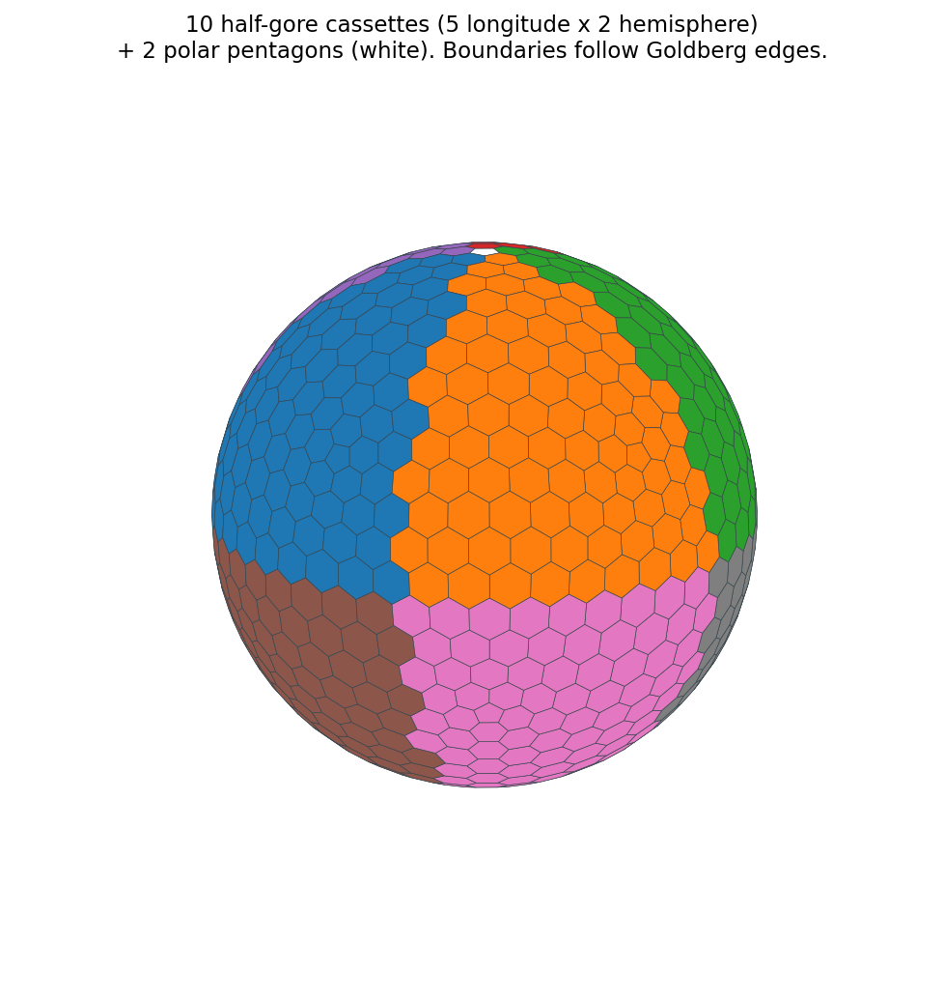
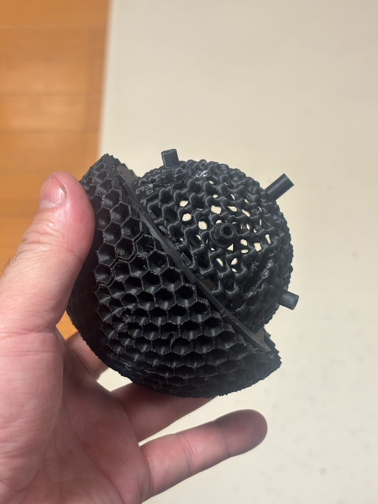

# Grape FPC — the flexible LED panel

Grape FPC is the display surface of isolation-sphere. One panel is a
gore-shaped flexible PCB carrying 80 WS2812C-2020-V6 LEDs and 80
capacitors. Ten identical panels form the sphere: 800 LEDs in total.

## Why this shape

The LED positions come from a Goldberg polyhedron, G(9,0), T=81:
800 hexagons carry one LED each at the face centre, and 12 pentagons
carry none. A Goldberg layout was chosen over a Fibonacci sphere
because the design needs faces, edges and adjacency — for the
single-stroke wiring and for dividing the sphere into cassettes —
and because its 5-fold symmetry makes all ten panels congruent:
5 north pieces rotated by 72° and 5 south pieces mirrored at the
equator, all from a single Gerber. A Fibonacci sphere gives only
points, no faces, and its poles become visible landmarks when the
ball rotates.

The panel outline follows the Goldberg edges, so the ten panels meet
in a zig-zag seam and no LED sits on a cut line. The two polar
pentagons are excluded from the panels and become the pole caps.

## One panel

| Item | Value |
|---|---|
| LEDs | 80 × WS2812C-2020-V6 |
| Capacitors | 80 × 0603, one per LED |
| Connectors | 2 pin headers |
| Pads | 486 |
| Size | about 68 × 85 mm (gore shape) |
| Quantity per ball | 10 identical panels |

The 80 LEDs on a panel are wired in a single daisy chain. Two
panels join at the equator to make one data channel of 160 LEDs, so
the ball has 5 strips × 160 LEDs, driven in parallel.

## Cassette system

The panels are not glued. Each panel is a replaceable cassette,
held mechanically by the back_gore frame and connected at the
equator by pogo pins to the mother-ring. If one LED in a chain
fails, only that cassette is swapped — the rest of the ball is
untouched. This follows directly from the design rule of the whole
project: zero adhesive, cassette-swappable, FPC-based skeleton.
That rule exists because the ball is a juggling prop: it is dropped,
and a glued build that cannot be repaired is a total loss.

## Not a shield

The wiring looks like a mesh, but it is not one, and that is
intentional. The copper is a single stroke, not a closed mesh, and
the cassettes have seams, so it cannot act as an electromagnetic
shield. Copper is also non-magnetic, so the Earth's magnetic field
passes through and reaches the BNO055 IMU inside, which needs it
for heading, and Wi-Fi from the controller inside still works. If
shielding is ever needed, it belongs around the specific part, not
across the whole sphere.

## Manufacturing

- Designed in KiCad. The EasyEDA project published for the
  EasyEDA Spark 2026 entry is a port of this design; verifying
  the port against the production Gerbers is part of the
  publication process.
- Fabricated and assembled by JLCPCB (flexible PCB + SMT assembly).
- Coverlay colour: black in the exhibited build. A white coverlay
  is under evaluation — the black FPC shows through the shell's
  hexagonal holes as a dark pattern when the ball rotates, which is
  visible in the white-shell build.

## Further reading

- Project overview (note, English):
  https://note.com/taj_mahal/n/n34240e8664a7?hl=en
- Distributing Points Evenly on a Sphere — Goldberg Polyhedra vs
  Fibonacci Spheres (Zenn, English):
  https://zenn.dev/sastle/articles/8249f953d4f017?locale=en
- Generating Goldberg Polyhedra with NumPy (Zenn, English):
  https://zenn.dev/sastle/articles/4156ddb961e4da?locale=en
- Dividing a Spherical Shell into Watertight Parts Without Boolean
  Operations (Zenn, English):
  https://zenn.dev/sastle/articles/d5dfab18aa2500?locale=en
