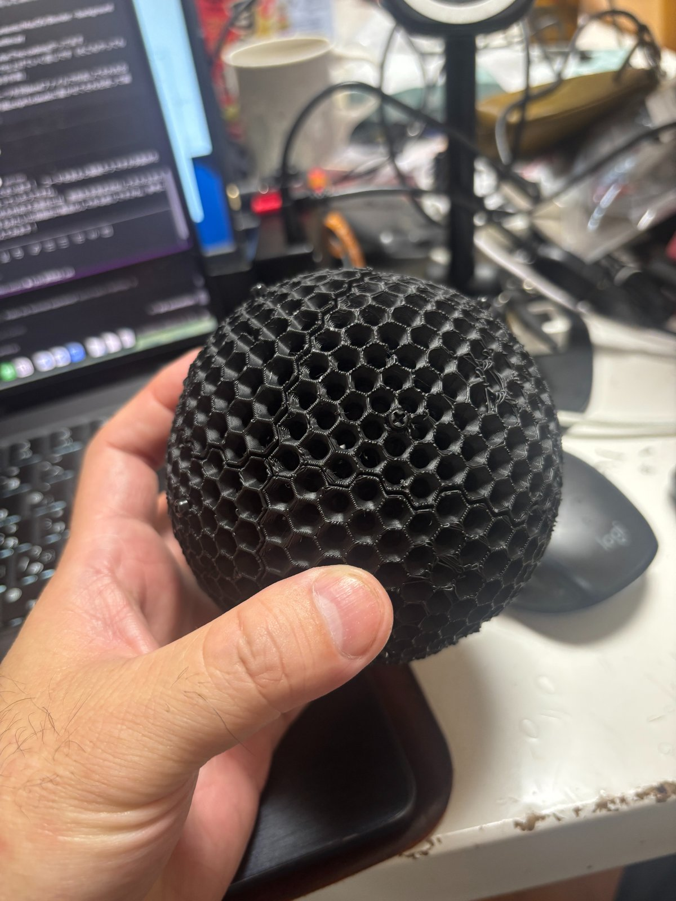
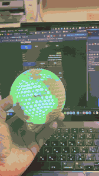

# System overview

isolation-sphere is a 100 mm contact-juggling ball that plays video
on its own surface. 800 WS2812 LEDs cover the sphere, and a BNO055
IMU re-maps the image every frame so the picture stays fixed in
space while the ball rolls and spins in your hand.





## Modes

- **Solo (current build):** the ball runs on its own. A 320×160
  MJPEG video is stored in LittleFS; power on and it loops
  automatically. To change the video, scan the QR sticker on the
  ball, join the ball's own Wi-Fi access point and upload a new
  video from the web UI. No server, no router, no internet.
- **Server (earlier build):** video is streamed from a server over
  UDP and control goes over MQTT. This mode is retained in the
  firmware; the solo build is the one being prepared for
  small-lot production.

## Boards

| Board | Role |
|---|---|
| Grape FPC × 10 | Display surface: 80 LEDs each, 800 in total (see `design-grape-fpc.md`) |
| core-XIAO-04 | Controller board (Seeed XIAO ESP32S3) |
| north-pole-04 | North-pole board (hall sensor for the magnet on/off) |
| mother-ring-04 | Equator ring: pogo-pin connections between cassettes |
| power-AB (A / B) | Power boards: charging, fuel gauge, power control |
| charge-connector-06 | South-pole magnetic charging terminal |

All boards were designed in KiCad. For the EasyEDA Spark 2026
entry, the Grape FPC has been ported to EasyEDA and published on
OSHWLab; the other boards are documented here and can be ported
later.

## How the image reaches the surface (solo mode)

```
Stored video (320×160 MJPEG, 10 fps, LittleFS)
      │
      ▼
XIAO ESP32S3 — decode
      │
      ▼
IMU (BNO055, 100 Hz) — attitude → re-map the frame
      │
      ▼
5 parallel outputs → 800 LEDs at 50–60 Hz
```

## Power

- Battery: 2S 2000 mAh LiPo × 2 (14.8 Wh)
- Charger: BQ25792 (5–12 V input)
- Fuel gauge / protection: BQ28Z620
- Power control: LTC2954 + DRV5032FC hall sensor — the magnet at
  the south pole switches the ball on and off
- Charging: south-pole magnetic terminal

Measured figures, with conditions, are in `measurements.md`.
Full-load operation (white, maximum brightness) has not been
verified yet.
